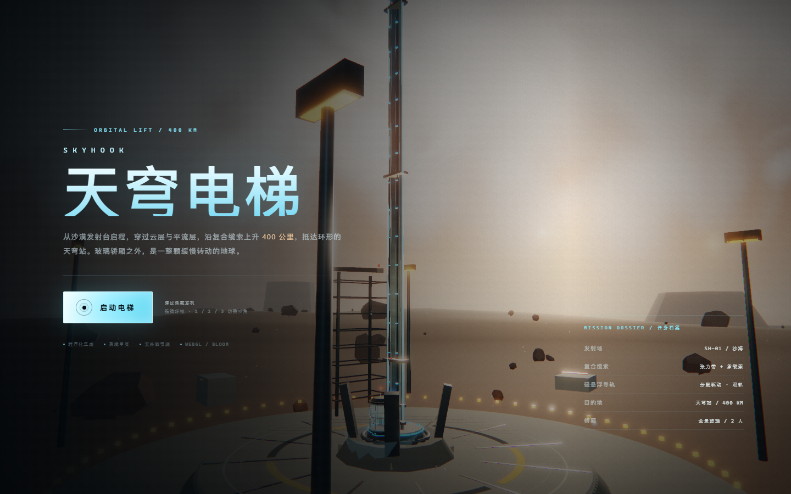
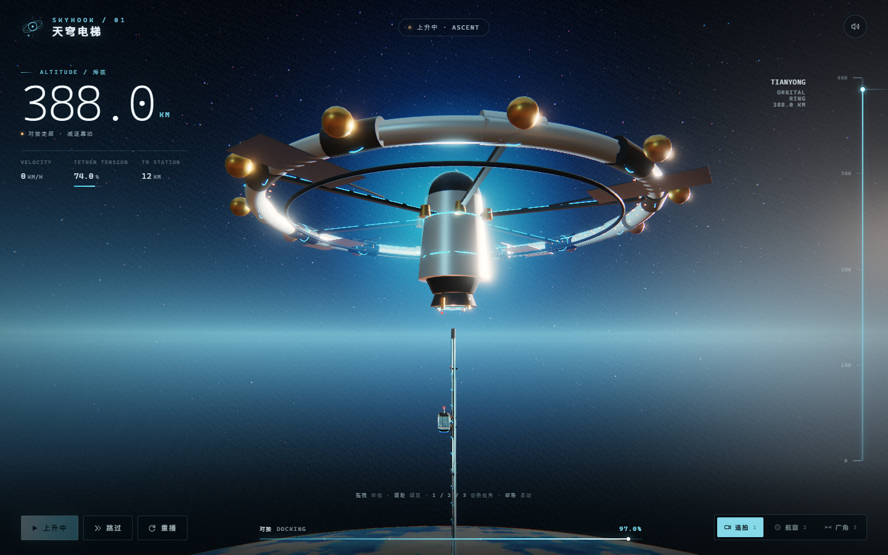
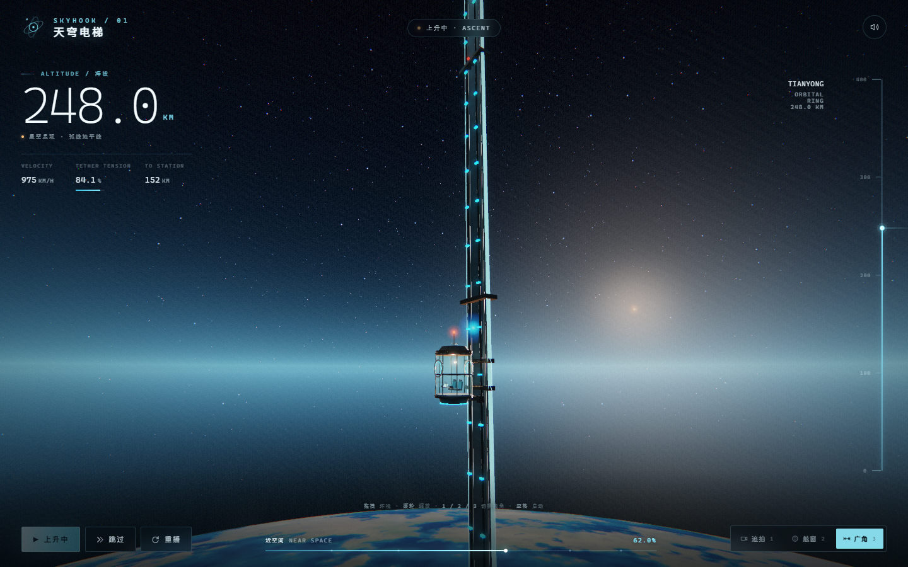
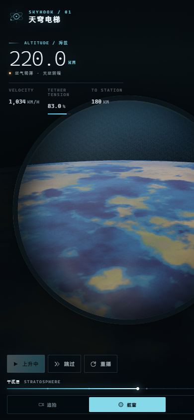

# 天穹电梯 / SKYHOOK

一个**离线单页 3D 太空电梯体验**：从沙漠发射台点火升空，沿复合缆索爬升 400 km，最终与环形天穹站对接。

**在线预览** → https://cyhnanfeng.github.io/skyhook/

单文件、零依赖：Three.js、全部着色器、贴图、音效都已内联或程序化生成，双击 `index.html` 即可运行，不需要服务器、不需要联网、不加载任何外部资源。

[](https://cyhnanfeng.github.io/skyhook/)

| 97% 对接：环形天穹站 | 62% 近空间：广角视角 |
| --- | --- |
|  |  |



## 目录结构

```
skyhook/
├─ index.html               ← 构建产物 / 成品，双击即玩（约 745 KB）
├─ preview/                 ← 预览截图
│  ├─ 01-intro.png          开场：沙漠发射台
│  ├─ 02-dock.png           97% 对接：环形天穹站
│  ├─ 03-space.png          62% 近空间：广角视角
│  └─ 04-mobile.png         手机竖屏：舷窗视角
├─ src/
│  ├─ 00-core.js            渲染器 / Bloom 后期 / 程序化 WebAudio
│  ├─ 10-world.js           沙漠、发射场、复合缆索、玻璃轿厢、地球、空间站
│  ├─ 20-mission.js         时间线、摄像机、HUD、交互、状态机
│  ├─ style.css             HUD 与界面样式
│  └─ index.template.html   HTML 骨架
├─ build.mjs                构建脚本（把源码内联成单文件 HTML）
└─ three.min.js             Three.js r128（本地副本）
```

## 操作

| 操作 | 说明 |
| --- | --- |
| 启动电梯 / 空格 | 点火升空（完成态时空格为“再飞一次”） |
| 跳过 | 直接跳到 97.5%（388 km）对接走廊 |
| 重播 | 从发射台重新开始 |
| 拖拽 | 环视（追拍/广角绕轿厢旋转，舷窗为转动视线） |
| 滚轮 / 双指捏合 | 缩放（0.62×–1.7×） |
| 1 / 2 / 3 | 追拍 / 舷窗 / 广角 |
| M | 静音切换 |
| R | 重播 |
| 方向键 | 微调视角 |

## 场景与实现要点

- **复合缆索**：宽幅张力带（程序化石墨纹理）+ 8 根承载索 + 2 条分段磁悬浮导轨（InstancedMesh）+ 30 单位一道张力环 + 流动能量脉冲。
- **玻璃轿厢**：双层玻璃壳、金属骨架、舷窗框、内部双座与操控台、底部磁悬浮转向架、顶部信标；追拍/舷窗/广角三种机位。
- **程序化场景**：18 km 沙漠地形（fbm 高度场 + 顶点色 + 曲率下沉）、岩石/台地/发射塔/泛光灯/围界灯、Canvas 生成的停机坪标线。
- **地球**：12000 单位半径的程序化星球着色器（大陆、海洋、海岸线、极冠、云带、晨昏线、大气边缘），随高度从地平线升起。
- **天穹站**：58 半径环体、6 根辐条、12 个舱段、190 扇实例化舷窗、中心枢纽、对接锥、太阳能翼、导航灯与光晕。
- **后期**：自建 Bloom（亮度提取 → 4 级可分离高斯模糊 → 合成），ACES 色调映射、色差、暗角、胶片颗粒。
- **音频**：WebAudio 全程序化——和声铺底、风噪、低频嗡鸣、卷积混响、点火轰鸣、阶段提示音、对接和弦；首次点击后启用。

## 重新构建

需要 Node.js 18+（无需 `npm install`）：

```bash
node build.mjs
```

脚本读取 `src/` 与 `three.min.js`，把 CSS、Three.js、三个 JS 模块内联，输出 `index.html`。

## 说明

- 时间线约 74.6 秒（点火 2.6 s + 爬升 72 s），进度与海拔（0–400 km）线性对应，为观感做了压缩。
- 首次点击“启动电梯”才会初始化音频（浏览器自动播放策略要求用户手势）。
- 手机端为竖屏/横屏自适应布局，触摸拖拽与双指缩放已适配。
- 文件完全离线：0 个外部 `src`/`href`，唯一 http 字符串是 SVG 的 XHTML 命名空间声明。
